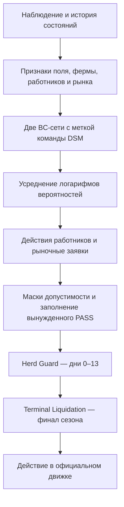

# Kaggriculture — от урожая до выручки


ИИ-агент для управления фермой в соревновании **Kaggriculture**. Он распределяет работу фермера и помощников, выращивает культуры, содержит животных и торгует на динамическом рынке. За 30 игровых дней нужно закончить сезон с большей суммой денег, чем соперник.

Команда **misis biznessmenlb** заняла **95-е место из 10 148 команд**, получила **серебряную медаль** и вошла в **топ-1%**. Итоговый рейтинг команды — **4780.1**. В финальной таблице указан агент `bc_hg_m26dsm_d13_tl`, submission **56705019**. [Соревнование](https://www.kaggle.com/competitions/kaggriculture) · [Итоговый рейтинг](https://www.kaggle.com/competitions/kaggriculture/leaderboard)

Основа решения — **behavioral cloning**, обучение на действиях сильных игроков. Две нейросети объединены в ансамбль, а правила защиты стада и финальной распродажи исправляют конкретные ошибки исполнения. Обучение реализовано на PyTorch, готовые агенты работают на CPU с NumPy.

## Содержание

- [Задача и метрика](#задача-и-метрика)
- [Два финальных решения](#два-финальных-решения)
- [Архитектура](#архитектура)
- [Данные и обучение](#данные-и-обучение)
- [Валидация](#валидация)
- [Результаты и эксперименты](#результаты-и-эксперименты)
- [Запуск и воспроизведение](#запуск-и-воспроизведение)
- [Структура репозитория и стек](#структура-репозитория-и-стек)
- [Команда и вклад](#команда-и-вклад)
- [Выводы и дальнейшее применение](#выводы-и-дальнейшее-применение)
- [Источники и лицензия](#источники-и-лицензия)

## Задача и метрика

Два игрока развивают отдельные фермы и взаимодействуют через общий рынок. Агент получает наблюдение о состоянии игры и каждый ход выбирает действия фермера, помощников и последовательность рыночных заявок. Выращивание культур, содержание животных, покупка земли и наём работников требуют денег и времени. Цены зависят от торговли и спроса города.

На языке RL это игра с конечным горизонтом и отложенными последствиями действий. Например, покупка животного окупается будущей продукцией, если агент успевает кормить его и продавать результат. Финальная политика обучена методом имитационного обучения с учителем по демонстрациям экспертов.

Победитель партии определяется по деньгам в банке в конце сезона. Рейтинг соревнования учитывает исходы матчей и силу соперников. Денежный перевес внутри игры используется в наших экспериментах как дополнительная метрика. В официальном движке версии 1.32.7 агент получает 719 вызовов, последний индекс шага — 718. Продать товар необходимо до завершения последнего рынка. [Правила и оценка](https://www.kaggle.com/competitions/kaggriculture/overview) · [Официальный worker в репозитории](game_worker.py)

## Два финальных решения

| Решение | Состав | Kaggle submission | Исходник и описание |
|---|---|---|---|
| `bc_hg_m26dsm_d13` | Ансамбль BC, метка DSM, защита стада в дни 0–13 | **56700512**, 30.09.2026 | [main.py](lab/pavel/candidates/bc_hg_m26dsm_d13/main.py) · [Описание](lab/pavel/candidates/bc_hg_m26dsm_d13/README.md) |
| `bc_hg_m26dsm_d13_tl` | Базовая версия с возвратом груза и финальной распродажей | **56705019**, 30.09.2026 | [main.py](lab/pavel/candidates/bc_hg_m26dsm_d13_tl/main.py) · [Описание](lab/pavel/candidates/bc_hg_m26dsm_d13_tl/README.md) |

Каждый `main.py` содержит веса, вычисление признаков и функцию `agent(obs, config=None)`. Экспорт хранит веса в float16 со сжатием, при загрузке вычисления переводятся в float32. Для инференса нужны NumPy и стандартная библиотека Python. [Экспорт модели](lab/pavel/bc3/export3.py)

| Файл | SHA-256 |
|---|---|
| `bc_hg_m26dsm_d13/main.py` | `b3ab57b98cd887e749583966d91ff2d87978122007469146681a5b0ede989d89` |
| `bc_hg_m26dsm_d13_tl/main.py` | `d03146b1b854753a3b6345b032f833f9ba2b29483119b510e25a29458d82735b` |

## Архитектура



Каждая сеть использует свёрточный ResNet для поля 10×10. Головы действий предсказывают операцию работника, целевую клетку и количество товара. Авторегрессионный декодер рынка на GRU формирует заявки последовательно, учитывая предыдущие заявки. При инференсе ансамбль усредняет логарифмы вероятностей двух моделей. **Action masking** исключает недопустимые действия, а включённый режим `--fill` подбирает полезную работу при вынужденном пропуске хода. [Модель](lab/pavel/bc3/train3.py) · [Выбор действий](lab/pavel/bc3/agent3.py)

**Herd Guard (HG)** защищает животных от побега после двух дней без корма. В начале дня агент старается обеспечить запас пшеницы по числу животных с учётом корма в руках работников. При угрозе пропустить повторное кормление правило перенаправляет работника, при необходимости докупает пшеницу и отменяет её продажу. У финальных агентов правило активно в дни 0–13 включительно. [Код HG](lab/pavel/hg/hg_layer_v2.py)

**Terminal Liquidation (TL)** переводит оставшуюся продукцию в деньги до окончания игры. С шага 690 работник с товаром возвращается к складу, когда оставшегося времени становится впритык на дорогу и сдачу. При `718 - step <= 3` блокируется забор продукции со склада. С шага 712 продажи распределяются по оставшимся ходам, а на шаге 718 продаётся весь доступный товар с учётом сдачи на этом же ходу и вместимости склада. Этот слой добавлен только в версию `_tl`. [Код TL](lab/pavel/tl/tl_layer.py)

## Данные и обучение

Обучающие примеры построены из записей партий сильных команд. Финальная конфигурация объединяет **26 наборов** — 15 прежних и 11 командных выборок из официального датасета за 28 сентября. В свежем источнике было **599 игр** топ-команд друг против друга. Число 26 обозначает наборы данных, среди которых встречаются повторные команды. [Описание данных финалиста](lab/pavel/candidates/bc_hg_m26dsm_d13/README.md)

Подготовка данных включает восстановление наблюдений и канонизацию рыночных действий по фактическому исполнению в движке. Частично исполненные заявки получают фактическое количество, нулевые операции исключаются из обучающих меток в режиме `--nonoop`. Порядок заявок сохраняется, поскольку он влияет на результат торговли. [Канонизация](lab/pavel/canon_market.py) · [Сборка примеров](lab/pavel/bc3/build3.py)

Вектор признаков дополнен one-hot меткой набора команды. Получается **условная политика** — одна сеть обучается на нескольких стилях игры, а при экспорте ей задаётся метка `o28_dsm_cn`. Для финального ансамбля обучены модели `multi26_s0` и `multi26_s1` с разными seed.

| Параметр | Значение |
|---|---|
| Метод | Supervised behavioral cloning |
| Моделей в ансамбле | 2 |
| Эпох | 16 на модель |
| Batch size | 256 |
| Learning rate | 0.001 |
| Weight decay | 0.0001 |
| ResNet | 128 каналов, 8 residual-блоков |
| Hidden size | 256 |
| Seed обучения | 0 и 1 |
| Метка при инференсе | `o28_dsm_cn` |

Параметры взяты из сохранённого [сценария обучения](lab/pavel/scripts/overnight_o28.sh).

## Валидация

Проверка качества проходит на двух уровнях. При обучении оценивается предсказание действий на отложенных файлах эпизодов. Для выбора игрового агента используются полные партии против реагирующих соперников, поскольку ошибки политики меняют будущие наблюдения и могут накапливаться по ходу игры — **distribution shift** при замкнутом исполнении.

`train3.py` откладывает по 12 файлов эпизодов внутри каждого набора. Глобальная группировка одного исходного матча между разными наборами в этой реализации не обеспечена. При новом обучении требуется отдельно проверить пересечение эпизодов и объединить обе стороны одного матча в одну группу разбиения. [Реализация split](lab/pavel/bc3/train3.py)

Для оценки игрового качества используются следующие правила.

- Кандидаты играют на одинаковых seed и за обе стороны.
- Отдельная игра запускается в новом процессе официального движка.
- Перед сравнением фиксируются исходники, соперники, бюджет и критерии выбора.
- Отчёт содержит победы, ничьи, поражения, ошибки, результаты по сторонам и соперникам, денежные потери и время исполнения.
- Доверительные интервалы строятся bootstrap-перевыборкой целых миров. Число партий и число независимых миров указываются отдельно.
- Просмотренные панели относятся к экспериментальным данным. Новая подтверждающая оценка требует новых заранее выбранных миров.

Проверки против записанных действий соперников используются для диагностики. Основные локальные показатели ниже получены против реагирующих агентов. [Стенд оценки](compare.py) · [Протокол](docs/validation_policy.md)

## Результаты и эксперименты

### Финальное соревнование

| Показатель | Значение |
|---|---|
| Команда | misis biznessmenlb |
| Финальное место | **95 / 10 148** |
| Медаль | **Серебро** |
| Финальный рейтинг | **4780.1** |
| Агент, указанный в финальной таблице | `bc_hg_m26dsm_d13_tl`, submission `56705019` |

Источник — [финальная таблица Kaggle](https://www.kaggle.com/competitions/kaggriculture/leaderboard). Контекст локальных исследований и архивные материалы собраны в [каталоге экспериментов](docs/EXPERIMENTS.md).

### Локальные сравнения

| Проверка | Миры × стороны | Партий | Результат |
|---|---|---|---|
| Базовый `m26dsm_d13` против 16 соперников поля | 32 × 2 | 1024 | **984 победы, 96.1%** |
| Полная лига, включая 3 внутренних соперника | 32 × 2 | 1216 | **1157 побед, 95.1%** |
| База против `m15ens_d13` | 32 × 2 | 64 | **59 побед, 92.2%** |
| База против `mix4_d13` | 32 × 2 | 64 | **58 побед, 90.6%** |
| TL против базовой версии | 16 × 2 | 32 | **24 победы, 75.0%**, средний перевес **+$292.7** |

В полной лиге из 1216 партий зарегистрировано 0 ошибок. 95% интервал доли побед по целым мирам — **91.7–97.8%**. За сторону 0 получено **580/608** побед, за сторону 1 — **577/608**. Худший денежный перевес составил **−$17 085**, в 24 партиях проигрыш превысил $5 000. Среди 16 соперников поля наименьшая доля побед была против `qA_ref` — **56/64, 87.5%**. [Отчёт лиги](lab/pavel/results/compare/m26dsm_league32/README.md) · [Агрегированные метрики](lab/pavel/results/compare/m26dsm_league32/summary.json)

Для TL против базы 95% интервал доли побед — **59.4–87.5%**. Худший перевес TL в этом сравнении составил **−$8 850**. На отдельной панели из 10 соперников обе версии имели 98.8% побед, а в записке кандидата зафиксирован прирост среднего денежного перевеса TL примерно **+$675 за игру**. Эта величина относится к панели, тогда как +$292.7 относится к прямым матчам против базы. [Очная проверка TL](lab/pavel/results/compare/tl_gate/README.md) · [Записка кандидата](lab/pavel/candidates/bc_hg_m26dsm_d13_tl/README.md)

### Что повлияло на выбор

| Эксперимент | Наблюдение |
|---|---|
| Метка команды DSM или Mother-Goose у одного ансамбля | На панели `o28_gate` доля побед составила 98.8% и 92.8% соответственно |
| Полный TL или только продажа на последнем ходу | Против базы полный TL выиграл 24/32, вариант `tlfinal` получил 20 побед, 2 ничьи и 10 поражений, score rate 65.6% |
| Увеличение ансамбля до 3–4 моделей на прежних 15 наборах | В журнале отмечено отсутствие улучшения против семейства tetsu |

Эти проверки относятся к разным экспериментам и панелям. История решений и отрицательные результаты сохранены в [FINDINGS.md](lab/pavel/notes/FINDINGS.md), [описании базы](lab/pavel/candidates/bc_hg_m26dsm_d13/README.md) и [отчёте TL](lab/pavel/results/compare/tl_gate/README.md).

## Запуск и воспроизведение

### Подготовка окружения

Полный снимок содержит около **3.8 ГБ** файлов, включая архив экспериментов. Для клонирования и рабочей копии удобно предусмотреть 10 ГБ свободного места.

Команды рассчитаны на Python 3.12, Linux или macOS и чистый checkout тега `v1.0.0`. Готовые агенты запускаются на CPU. Для повторного обучения потребуется отдельное окружение с PyTorch и соответствующими данными.

```bash
git clone --branch v1.0.0 --single-branch https://github.com/ItamMigel/kaggriculture_misis_biznessmenlb.git
cd kaggriculture_misis_biznessmenlb

python3.12 -m venv .venv
source .venv/bin/activate
python -m pip install -r requirements.txt
python -m pip install --no-deps kaggle-environments==1.32.7

export OMP_NUM_THREADS=1
export OPENBLAS_NUM_THREADS=1
export MKL_NUM_THREADS=1
export VECLIB_MAXIMUM_THREADS=1
```

Закреплённые зависимости стенда — `numpy==2.5.3`, `jsonschema==4.26.0`, `requests==2.34.2` и `kaggle-environments==1.32.7`. Официальный движок загружается через `--no-deps` по схеме исходного comparison kit. [Зависимости](requirements.txt)

### Проверка сохранённых агентов

Следующая команда сверяет только `main.py` с записанными контрольными суммами.

```bash
python - <<'PY'
import hashlib
from pathlib import Path

root = Path("lab/pavel/candidates")
names = ["bc_hg_m26dsm_d13", "bc_hg_m26dsm_d13_tl"]
for name in names:
    folder = root / name
    checksums = {}
    for line in (folder / "sha256.txt").read_text().splitlines():
        digest, filename = line.split(maxsplit=1)
        checksums[filename.strip().lstrip("*")] = digest
    actual = hashlib.sha256((folder / "main.py").read_bytes()).hexdigest()
    if actual != checksums["main.py"]:
        raise SystemExit(f"Checksum mismatch for {name}")
    print(f"OK {name}")
PY
```

### Две партии между финальными версиями

Агента вызывает игровой движок через функцию `agent`. Команда ниже запускает TL против базы на seed 0 за обе стороны. Каждая партия выполняется в новом процессе через сохранённый `game_worker.py`.

```bash
python - <<'PY'
import json
import subprocess
import sys
from pathlib import Path

root = Path.cwd()
base = root / "lab/pavel/candidates/bc_hg_m26dsm_d13/main.py"
tl = root / "lab/pavel/candidates/bc_hg_m26dsm_d13_tl/main.py"
for seat in (0, 1):
    job = {
        "candidate": "tl",
        "candidate_path": str(tl),
        "opponent": "base",
        "opponent_path": str(base),
        "seed": 0,
        "seat": seat,
    }
    process = subprocess.run(
        [sys.executable, str(root / "game_worker.py")],
        input=json.dumps(job), text=True, capture_output=True,
        check=True, timeout=1800, cwd=str(tl.parent),
    )
    result = json.loads(process.stdout)
    if "error" in result:
        raise RuntimeError(result)
    print(json.dumps({
        key: result[key]
        for key in ("seed", "seat", "status", "calls", "rewards", "margin")
    }, ensure_ascii=False))
PY
```

Успешный результат содержит `status` со значениями `DONE` для обоих игроков и `calls` со значениями 719. Эти две партии проверяют работоспособность. Seed 0 уже использовался при разработке.

### Сравнение на нескольких мирах

Общий стенд сначала проверяет исходники и документацию по `MANIFEST.json`. Манифест обновлён для опубликованного снимка. Для нового эксперимента задайте новый каталог результатов.

```bash
python compare.py --verify-only

python compare.py \
  --agent tl=lab/pavel/candidates/bc_hg_m26dsm_d13_tl/main.py \
  --opponent base=lab/pavel/candidates/bc_hg_m26dsm_d13/main.py \
  --baselines \
  --seeds 0 1 2 3 \
  --workers 2 \
  --game-timeout 1800 \
  --out runs/readme_tl_vs_base
```

Будут запущены 8 партий на 4 мирах со сменой сторон. Пустой `--baselines` задаёт единственного указанного соперника. Каталог результатов должен быть новым. В нём появятся `manifest.json`, `summary.json`, `games.jsonl` и `README.md`. Seeds 0–3 в этом примере служат демонстрацией запуска. Для новой оценки качества нужен заранее зафиксированный набор миров и более разнообразные соперники.

### Повторное обучение

Код подготовки данных, обучения и экспорта сохранён. Полный тренировочный корпус, исходные `best.pt` моделей `multi26_s0/1` и список прежних 15 наборов из `multi15_s0/split.json` в этом снимке Git отсутствуют. Поэтому воспроизводимость готовой политики обеспечивается сохранёнными `main.py`, а обучение с нуля требует восстановления этих входных данных.

Сохранённая последовательность этапов следующая.

1. `lab/pavel/canon_market.py` восстанавливает исполненные рыночные заявки из партий.
2. `lab/pavel/bc3/build3.py` создаёт примеры с наблюдениями, действиями и метками команды.
3. `lab/pavel/bc3/train3.py` обучает две сети с параметрами из раздела выше.
4. `lab/pavel/bc3/export3.py` экспортирует ансамбль с `--fill --team o28_dsm_cn`.
5. К экспорту добавляется `hg_layer_v2.py` с `active_last_day=13`, затем для TL-версии — `tl_layer.py`.

Исторический сценарий содержит пути и настройки машины автора, которые нужно адаптировать к своей среде. [Сценарий обучения и сборки](lab/pavel/scripts/overnight_o28.sh)

## Структура репозитория и стек

Основное дерево содержит финальную линию из `pavel-lab`. Остальные ветки сохранены в `experiments/branches/` с исходной внутренней структурой. Архив включает данные, чекпойнты, журналы обучения и результаты, находившиеся в этих ветках.

```text
kaggriculture_misis_biznessmenlb/
├── lab/pavel/
│   ├── candidates/
│   │   ├── bc_hg_m26dsm_d13/       # База, описание, SHA-256
│   │   └── bc_hg_m26dsm_d13_tl/    # Финальная версия с TL
│   ├── bc3/                       # Признаки, данные, обучение, экспорт
│   ├── canon_market.py            # Канонизация рыночных меток
│   ├── hg/                        # Защита стада
│   ├── tl/                        # Финальная распродажа
│   ├── results/compare/           # Отчёты локальных сравнений
│   ├── scripts/                   # Исторические сценарии экспериментов
│   └── notes/                     # Находки, состояние, передача результатов
├── lab/bc/                        # Базовые признаки BC
├── lab/gpuenv/                    # Экспериментальная среда для обучения
├── experiments/branches/          # Снимки main, adil-lab и adil-board
├── docs/EXPERIMENTS.md             # Навигация по экспериментам и данным
├── docs/PROVENANCE.json            # Исходные версии и состав переноса
├── agents/                        # Более ранние агенты Horizon
├── compare.py                     # Парные сравнения и отчёты
├── game_worker.py                 # Одна игра в отдельном процессе
├── stability_report.py            # Агрегация и статистика
├── requirements.txt
├── LICENSE
└── NOTICE.md
```

| Назначение | Технологии |
|---|---|
| Обучение политики | Python, PyTorch, ResNet, GRU, supervised behavioral cloning |
| Инференс | NumPy, ансамбль двух сетей, маски действий, правила HG/TL |
| Подготовка данных | NumPy, JSON, канонизация по официальному движку |
| Оценка | kaggle-environments 1.32.7, subprocess, парные матчи, bootstrap по мирам |
| Восстановление версии | Git commit, SHA-256, автономные `main.py` |

## Команда и вклад

Команда **misis biznessmenlb** объединила исследования ML-политик, анализ экономики игры и разработку стенда оценки.

> Подробные списки для Алексея Калинина и Даниила Сергеева ниже являются предлагаемым распределением задач для согласования с участниками. История репозитория подтверждает наличие этих работ в проекте, но индивидуальная атрибуция каждого пункта пока требует подтверждения.

### Алексей Калинин — ML-разработка и организация экспериментов

[GitHub — ItamMigel](https://github.com/ItamMigel)

- Анализ правил, метрики соревнования и требований к автономному агенту.
- Разработка и сравнение ранних кандидатов семейства Horizon.
- Формирование гипотез о производстве, кормлении, торговле и завершении сезона.
- Организация парной оценки на одинаковых мирах с игрой за обе стороны.
- Подбор панели соперников и проверка устойчивости по отдельным подгруппам.
- Анализ рейтинга, денежных потерь и результатов экспериментальных версий.
- Подготовка воспроизводимых запусков, упаковки и проверки артефактов.
- Сведение результатов команды и оформление технической документации.

### Даниил Сергеев — данные, ML-эксперименты и анализ поведения

[GitHub — DaniilSergeev17](https://github.com/DaniilSergeev17)

- Исследование демонстраций сильных игроков и особенностей их стратегий.
- Работа с признаками поля, запасов, работников и рыночного состояния.
- Анализ представления действий, количеств товара и порядка рыночных заявок.
- Исследование behavioral cloning и вариантов условной политики.
- Сравнение ансамблей и настроек выбора действий.
- Разбор эпизодов с вынужденными пропусками, потерями животных и непроданным товаром.
- Анализ абляций, результатов по соперникам и различий между офлайн-метриками и полной игрой.
- Подготовка выводов по экспериментам и описания ограничений модели.

### Павел Сардак — финальная ветка BC

В `pavel-lab` сохранены разработка BC v3, канонизация рыночных меток, обучение финального ансамбля, слои HG/TL и отчёты сравнения кандидатов. Эта линия сохранена с указанием исходной версии в [описании происхождения материалов](docs/EXPERIMENTS.md).

### Адиль — исследования движка и анализ ошибок исполнения

Журнал проекта связывает с Адилем работу над ранним BC, экспериментальной средой и вариантами экономической политики. В описании TL ему отдельно приписано обнаружение непроданных остатков в конце партии. [Передача результатов BC](lab/pavel/notes/BC_FINDINGS.md) · [Описание TL](lab/pavel/candidates/bc_hg_m26dsm_d13_tl/README.md)

## Выводы и дальнейшее применение

Опыт сильных игроков дал основу политики, а анализ полных партий выявил потери, которые плохо отражались в точности предсказания отдельных действий. Защита стада учитывает будущий доход от животных, а TL связывает действия работников с оставшимся временем и итоговой денежной метрикой.

Дальнейшая работа может включать глобальную группировку обучающих эпизодов, временные и командные holdout-выборки, расширение набора независимых соперников и улучшение худших исходов. Архивные локальные панели и рейтинг фиксируют результат соревнования 2026 года. Для нового окружения качество требуется измерить заново.

Метод можно исследовать в складской логистике, распределении заданий сотрудникам и планировании ресурсов. Например, политика учится по истории работы диспетчеров, а правило дедлайна возвращает комплектовщика к погрузке до отправления машины. Такое применение потребует данных конкретного процесса и проверки в его условиях.

## Источники и лицензия

- [Kaggriculture](https://www.kaggle.com/competitions/kaggriculture) и [официальный движок](https://github.com/Kaggle/kaggle-environments/tree/master/kaggle_environments/envs/kaggriculture).
- [Официальные эпизоды за 28 сентября 2026 года](https://www.kaggle.com/datasets/kaggle/kaggriculture-episodes-2026-09-28).
- [Материалы финальной ветки](lab/pavel) и [журнал находок](lab/pavel/notes/FINDINGS.md).
- В корне репозитория находится [лицензия Apache-2.0](LICENSE). Происхождение компонентов ранней линии Horizon и сторонние уведомления приведены в [NOTICE.md](NOTICE.md). Для внешних данных и компонентов действуют условия их источников.
